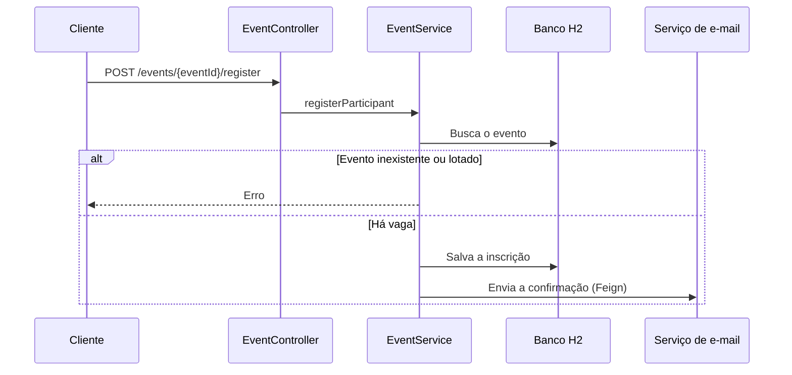

# Events Microservice


Microsserviço de eventos em Spring Boot. Ele cria e lista eventos e registra participantes. A cada inscrição, salva os dados e solicita o envio de um e-mail de confirmação a um serviço de e-mail externo, via Feign.

## Fluxo de inscrição



## Tecnologias

- Java 21 e Spring Boot 4
- Spring Web MVC e Spring Data JPA
- Spring Cloud OpenFeign
- Banco H2 em memória
- Springdoc OpenAPI (Swagger)
- Lombok
- Testes da camada de serviço e de repositório

## Endpoints

| Método | Rota | Descrição |
| --- | --- | --- |
| GET | `/events` | Lista todos os eventos |
| GET | `/events/upcomig` | Lista os próximos eventos |
| POST | `/events` | Cria um evento |
| POST | `/events/{eventId}/register` | Inscreve um participante |

### Criar um evento

```json
{
  "maxParticipants": 100,
  "registeredParticipants": 0,
  "date": "20/12/2026",
  "title": "Tech Conference",
  "description": "Evento de tecnologia"
}
```

### Inscrever um participante

```json
{
  "participantEmail": "participante@exemplo.com"
}
```

## Como executar

Pré-requisito: Java 21.

```bash
git clone -b dev https://github.com/gabriel-allencar/Events-Microservice.git
cd Events-Microservice/events-microservice
./mvnw spring-boot:run
```

A inscrição depende de um serviço de e-mail externo, que não faz parte deste repositório. O endereço está em `EmailServiceClient`.

Com a aplicação rodando na porta padrão:

- Swagger: `http://localhost:8080/swagger-ui.html`
- Console do H2: `http://localhost:8080/h2-console`

## Estrutura

```text
src/main/java/com/alencar/events_microservice
├── controllers    # Endpoints REST
├── domain         # Entidades JPA
├── dtos           # Dados de entrada
├── exceptions     # Erros de negócio
├── repositories   # Acesso a dados
└── services       # Regras de negócio e cliente Feign
```

## Autor

Gabriel Alencar: [LinkedIn](https://www.linkedin.com/in/gabriel-alencar-396544225/)
